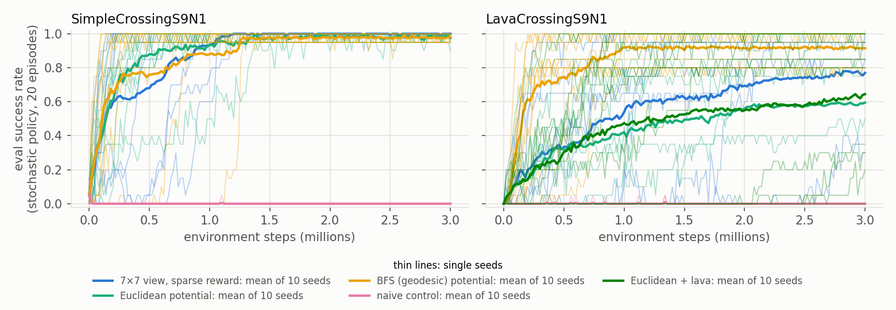

# Stage 9 — EXP-020 results: potential-based shaping against the sparse baseline (core)

**Workflow steps:** 10–11 (method; validation and ablations). **Experiment:** EXP-020, core phase.
**Status:** core done (all 80 runs finished; none failed, rerun or excluded). The shifted-potential extension
and EXP-021 are still to run.

## Question

The pre-registered questions of [stage 8](08_shaping_experiment.md):

- **RQ1.** Does PBRS with a distance potential make PPO learn faster on SimpleCrossing and LavaCrossing
  (7×7 view), without lowering final success?
- **RQ2.** Does the shape of the potential matter (Euclidean against BFS, with or without a lava term)?
- **RQ3.** Does the potential form matter (PBRS against a naive progress bonus)?

## What was done

- The core conditions ran exactly as pre-registered, from the code commit named in stage 8; `src/`, `configs/`
  and `tests/` were not changed before the analysis. The sparse baseline has 10 seeds per task: seeds 0–4 are
  the EXP-011 runs, seeds 5–9 were run with `potential: none`.
- Analysis with the pre-registered scripts:

  ```bash
  python src/analyze_minigrid.py experiments/EXP-011 experiments/EXP-020 --name exp020
  python src/compare_conditions.py results/tables/exp020_runs.csv --family exp020
  python src/loop_metrics.py experiments/EXP-011 experiments/EXP-020 --name exp020
  python src/behavior.py experiments/EXP-011 experiments/EXP-020 --name exp020
  python src/hypothesis_checks.py --name exp020
  ```

- Two analysis additions were made after the runs. Neither changes a number of the pre-registered metrics.
  - **The figure legend** of `analyze_minigrid.py` now lists the conditions of every panel. Before, it listed
    only those of the first panel, which left out the LavaCrossing-only condition. The per-run table is
    byte-identical before and after.
  - **`src/hypothesis_checks.py`** computes the exploratory table of stage 8. It merges the per-run tables of
    the three scripts and reports each check with `compare_conditions.py`.
    - Stage 8 names the metric "never-crossed timeouts" but not its denominator, so both forms are reported.
    - The first is the share of timed-out episodes in which the agent never stood on the goal side of the
      line, as in [stage 5](05_behavior_analysis.md). It is undefined for runs without timeouts.
    - The second is the same episodes as a share of all 100 episodes, which is defined for every run.
    - Both forms are given for the stochastic and the greedy policy.
- The rerun loop metrics of EXP-011 reproduce the earlier files byte for byte.

## Results

Final policies, mean ± SD over 10 seeds. Success, death and timeout use the stochastic policy on the 100
held-out episodes. The last column gives the steps to 50% success over the seeds that reached it.

| Task | Condition | Final success | AUC | Greedy success | Death | Timeout | Steps to 50% |
|---|---|---|---|---|---|---|---|
| Simple | sparse | 0.999 ± 0.003 | 0.890 ± 0.104 | 0.985 ± 0.034 | – | 0.001 | 0.32 ± 0.31M (10/10) |
| Simple | Euclidean | 0.970 ± 0.023 | 0.905 ± 0.075 | 0.872 ± 0.179 | – | 0.030 | 0.12 ± 0.07M (10/10) |
| Simple | BFS | 0.975 ± 0.017 | 0.883 ± 0.130 | 0.921 ± 0.050 | – | 0.025 | 0.27 ± 0.40M (10/10) |
| Simple | naive control | 0.000 ± 0.000 | 0.000 ± 0.000 | 0.000 ± 0.000 | – | 1.000 | never (0/10) |
| Lava | sparse | 0.756 ± 0.341 | 0.564 ± 0.321 | 0.652 ± 0.365 | 0.014 | 0.230 | 0.64 ± 0.58M (8/10) |
| Lava | Euclidean | 0.614 ± 0.402 | 0.448 ± 0.349 | 0.518 ± 0.426 | 0.150 | 0.236 | 0.99 ± 0.97M (7/10) |
| Lava | Euclidean + lava | 0.636 ± 0.344 | 0.466 ± 0.387 | 0.503 ± 0.370 | 0.186 | 0.178 | 0.52 ± 0.36M (6/10) |
| Lava | BFS | 0.929 ± 0.077 | 0.837 ± 0.091 | 0.837 ± 0.150 | 0.007 | 0.064 | 0.25 ± 0.22M (10/10) |
| Lava | naive control | 0.000 ± 0.000 | 0.000 ± 0.000 | 0.000 ± 0.000 | 0.008 | 0.992 | never (0/10) |

Training episodes in the first 500k steps (success / death / timeout, mean of per-run rates):

| Task | sparse | Euclidean | Euclidean + lava | BFS | naive control |
|---|---|---|---|---|---|
| Simple | 0.64 / 0 / 0.36 | 0.74 / 0 / 0.26 | – | 0.72 / 0 / 0.28 | 0.00 / 0 / 1.00 |
| Lava | 0.27 / 0.23 / 0.50 | 0.23 / 0.53 / 0.24 | 0.19 / 0.56 / 0.25 | 0.57 / 0.29 / 0.14 | 0.00 / 0.08 / 0.92 |



Tables:
- `results/tables/exp020_runs.csv` (per run);
- `exp020_runs_comparisons.csv` (confirmatory comparisons);
- `exp020_loops.csv` and `exp020_crossing.csv` (loop and line-crossing metrics);
- `exp020_hypotheses.csv` (hypothesis checks).

## Confirmatory comparisons

One metric (AUC) and nine comparisons, as pre-registered. B − A is the difference of mean AUC with its 95%
bootstrap interval. P(B > A) is the probability of improvement over all run pairs. The p-value comes from the
exact two-sided permutation test (10 against 10 runs), and the nine p-values are Holm-corrected together.

| # | Task | B against A | B − A [95% CI] | P(B > A) | p | Holm p | Difference claimed |
|---|---|---|---|---|---|---|---|
| 1 | Simple | Euclidean against sparse | +0.015 [−0.059, +0.090] | 0.45 | 0.708 | 1.000 | no |
| 2 | Simple | BFS against sparse | −0.007 [−0.108, +0.087] | 0.47 | 0.895 | 1.000 | no |
| 3 | Simple | BFS against Euclidean | −0.021 [−0.115, +0.060] | 0.52 | 0.696 | 1.000 | no |
| 4 | Simple | naive against Euclidean | −0.904 [−0.940, −0.855] | 0.00 | < 0.0001 | 0.0001 | yes: lower |
| 5 | Lava | Euclidean against sparse | −0.116 [−0.391, +0.163] | 0.37 | 0.441 | 1.000 | no |
| 6 | Lava | BFS against sparse | +0.273 [+0.089, +0.483] | 0.83 | 0.0083 | 0.0499 | yes: higher (at the threshold) |
| 7 | Lava | BFS against Euclidean | +0.389 [+0.181, +0.602] | 0.87 | 0.0017 | 0.0139 | yes: higher |
| 8 | Lava | Euclidean + lava against Euclidean | +0.018 [−0.285, +0.315] | 0.57 | 0.914 | 1.000 | no |
| 9 | Lava | naive against Euclidean | −0.448 [−0.647, −0.241] | 0.19 | 0.0027 | 0.0190 | yes: lower |

- Row 6 passes the pre-registered threshold of 0.05 by a small margin. Its interval and P(B > A) show the
  size and the uncertainty of the effect.
- In row 9, P(B > A) is 0.19 and not 0. Three Euclidean runs (seeds 1, 2 and 9) have an AUC of 0.0000 to
  0.0003, tied with or below the naive runs (0.0000 to 0.0013).

**Other primary metrics** (B − A, 95% bootstrap interval, no test). A run that never reaches a threshold
counts as 3M.

| Task | B against A | Final success | Steps to 50% | Steps to 80% |
|---|---|---|---|---|
| Simple | Euclidean against sparse | −0.029 [−0.043, −0.017] | −0.20M [−0.40M, −0.02M] | −0.10M [−0.39M, +0.22M] |
| Simple | BFS against sparse | −0.024 [−0.034, −0.014] | −0.05M [−0.33M, +0.26M] | −0.10M [−0.41M, +0.23M] |
| Lava | Euclidean against sparse | −0.142 [−0.447, +0.168] | +0.48M [−0.53M, +1.44M] | +0.45M [−0.47M, +1.32M] |
| Lava | BFS against sparse | +0.173 [−0.009, +0.398] | −0.86M [−1.57M, −0.23M] | −1.09M [−1.71M, −0.48M] |
| Lava | BFS against Euclidean | +0.315 [+0.084, +0.556] | −1.34M [−2.08M, −0.58M] | −1.53M [−2.19M, −0.83M] |

The RQ1 condition "without lowering final success" fails when the final-success interval lies entirely
below 0. That is the case for both potentials on SimpleCrossing (Euclidean −0.029, BFS −0.024). It holds for
both on LavaCrossing.

## Hypothesis checks (exploratory)

Mean of A → mean of B, with B − A, its 95% bootstrap interval and P(B > A). There is no test. "n" is the
number of runs with a value (A/B).

| Hypothesis | Task | B against A | Metric | A → B | B − A [95% CI] | P(B > A) | n |
|---|---|---|---|---|---|---|---|
| H-dead-end | Lava | BFS against Euclidean | never crossed, share of timeouts (stochastic) | 0.98 → 0.64 | −0.34 [−0.70, −0.04] | 0.33 | 7/7 |
| | | | never crossed, share of timeouts (greedy) | 0.88 → 0.75 | −0.13 [−0.29, +0.03] | 0.33 | 9/8 |
| | | | never crossed, share of all episodes (stochastic) | 0.231 → 0.061 | −0.170 [−0.312, −0.037] | 0.24 | 10/10 |
| | | | never crossed, share of all episodes (greedy) | 0.308 → 0.121 | −0.187 [−0.353, −0.024] | 0.27 | 10/10 |
| | | | revisit ratio | 0.299 → 0.093 | −0.207 [−0.370, −0.049] | 0.25 | 10/10 |
| H-dead-end | Simple | BFS against Euclidean | never crossed, share of timeouts (stochastic) | 0.75 → 0.22 | −0.53 [−0.86, −0.15] | 0.18 | 8/8 |
| | | | never crossed, share of timeouts (greedy) | 0.68 → 0.73 | +0.05 [−0.22, +0.32] | 0.53 | 10/10 |
| | | | never crossed, share of all episodes (stochastic) | 0.021 → 0.007 | −0.014 [−0.029, +0.001] | 0.29 | 10/10 |
| | | | never crossed, share of all episodes (greedy) | 0.085 → 0.044 | −0.041 [−0.120, +0.014] | 0.48 | 10/10 |
| | | | revisit ratio | 0.058 → 0.040 | −0.018 [−0.057, +0.012] | 0.40 | 10/10 |
| H-lava-a | Lava | Euclidean against sparse | training death rate, first 500k steps | 0.225 → 0.533 | +0.308 [+0.166, +0.441] | 0.90 | 10/10 |
| H-lava-b | Lava | Euclidean + lava against Euclidean | never crossed, share of timeouts (stochastic) | 0.98 → 0.86 | −0.12 [−0.38, +0.03] | 0.37 | 7/7 |
| | | | never crossed, share of timeouts (greedy) | 0.88 → 0.73 | −0.15 [−0.41, +0.07] | 0.42 | 9/10 |
| | | | never crossed, share of all episodes (stochastic) | 0.231 → 0.163 | −0.068 [−0.230, +0.090] | 0.46 | 10/10 |
| | | | never crossed, share of all episodes (greedy) | 0.308 → 0.340 | +0.032 [−0.173, +0.233] | 0.54 | 10/10 |
| H-naive | Simple | naive against Euclidean | greedy loop rate | 0.128 → 1.000 | +0.872 [+0.755, +0.948] | 1.00 | 10/10 |
| | | | revisit ratio | 0.058 → 0.883 | +0.824 [+0.788, +0.851] | 1.00 | 10/10 |
| | | | shaping return, timed-out episodes | 2.05 → 11.55 | +9.50 [+9.40, +9.60] | 1.00 | 10/10 |
| H-naive | Lava | naive against Euclidean | greedy loop rate | 0.355 → 0.997 | +0.642 [+0.477, +0.804] | 1.00 | 10/10 |
| | | | revisit ratio | 0.299 → 0.890 | +0.590 [+0.431, +0.743] | 1.00 | 10/10 |
| | | | shaping return, timed-out episodes | 2.50 → 10.99 | +8.49 [+7.95, +9.00] | 1.00 | 10/10 |

- The shaping return is the undiscounted sum of F over a training episode, averaged over all training
  episodes with that outcome. The table also has it for successful episodes and for deaths.
- H-offset is tested by the extension, which has not run yet.
- Sparse reference values (not part of a check): on LavaCrossing, never crossed as a share of timeouts is
  0.79 (stochastic) and 0.91 (greedy), and the revisit ratio is 0.27.

## Observations

1. **Euclidean potential.**
   - On neither task is a difference in AUC from the sparse baseline detected (rows 1 and 5).
   - On LavaCrossing, 3 of 10 Euclidean runs never learn: AUC ≈ 0, final success 0.09, greedy success 0,
     and final death rates of 0.54, 0.58 and 0.24.
   - In the sparse baseline, 2 of 10 runs stay at AUC ≤ 0.04.
2. **BFS potential.**
   - On LavaCrossing it learns faster than both the sparse baseline (row 6, at the threshold) and the
     Euclidean potential (row 7).
   - All 10 BFS runs reach AUC ≥ 0.72 and final success ≥ 0.84. The between-seed SD of final success falls
     from 0.34 (sparse) to 0.08.
   - On SimpleCrossing it does not differ from the baseline or the Euclidean potential.
3. **Final success on SimpleCrossing.** Both potentials end slightly below the sparse baseline: 0.970 and
   0.975 against 0.999.
   - The difference comes from timeouts: timeout rates of 0.030 and 0.025, against 0.001 for sparse.
   - The greedy policies loop more: loop rates of 0.13 and 0.08, against 0.015 for sparse.
4. **The naive control fails completely.**
   - None of the 20 runs learns: the success rate of the training episodes rounds to 0.00 in every window
     after the first 50k steps.
   - The greedy policies loop in practically every episode.
   - A timed-out training episode collects about 11 in shaping return, 4 to 6 times more than under the
     Euclidean potential.
5. **Deaths with the Euclidean potential on LavaCrossing.** In the first 500k steps, more than half of all
   training episodes end in lava (0.53), against 0.23 for sparse.
   - Adding the lava term does not lower this rate (0.56).
   - The final death rate is 0.15 for Euclidean and 0.19 for Euclidean + lava, against 0.01 for sparse and
     BFS.
6. **The dead end.** On LavaCrossing, almost every stochastic timeout under the Euclidean potential is an
   episode that never crossed the line (0.98).
   - Under BFS, both the share of such episodes and the revisit ratio are lower.
   - With BFS, timeouts also become rarer overall: a final timeout rate of 0.064, against 0.236.
7. **The lava term** has no detectable effect: AUC +0.02 [−0.29, +0.32], and every never-crossed interval
   includes 0.

## Interpretations

- **RQ1.**
  - A potential-based distance signal alone does not make PPO learn faster here. The Euclidean potential gives
    no detectable gain on either task.
  - The geodesic potential gives a gain only on the task where the baseline struggles. On SimpleCrossing the
    baseline is already near the ceiling (AUC 0.89), so there is little room to improve.
  - On SimpleCrossing, both potentials lower final success slightly. RQ1's condition therefore does not hold
    there.
- **RQ2: the shape of the potential matters on LavaCrossing.**
  - The BFS–Euclidean difference is large: about +0.39 AUC.
  - Three exploratory measurements under the Euclidean potential are consistent with H-dead-end: more
    episodes that never cross the line, more revisits, and runs that never learn.
  - They are also consistent with H-lava-a: more early lava deaths, as the +d/D bonus for the step into lava
    predicts.
  - Where exactly the Euclidean agents stall was not measured. That they stop at the local maximum of the
    potential next to the line (stage 7) is plausible but not shown.
- **Why the Euclidean potential is not better than sparse on LavaCrossing.** The denser signal may be offset by
  the dead end and the extra early deaths, the two effects predicted in advance. This is an interpretation;
  the experiment does not separate the two.
- **The lava term (c = 1/D) has no detectable effect.**
  - It does not reduce the early deaths. This fits its known limit (H-lava-b): it cannot penalize the fatal
    step itself.
  - H-lava-b's prediction that the term makes crossing harder is not supported either.
  - With an AUC SD of about 0.35 between seeds, a moderate effect in either direction cannot be excluded.
- **RQ3: the potential form matters.** The naive bonus is not potential-based, and the agent exploits it: it
  loops and collects bonus instead of reaching the goal. This is the cycle argument of Ng et al. (1999), and
  the result is consistent with H-naive.
- **Lower final success on SimpleCrossing (not predicted).** PBRS keeps the optimal policy, but not
  necessarily what PPO finds with a finite budget. Possible reasons, none of them tested:
  - With Φ < 0 everywhere, every step that does not change the cell earns a small positive bonus,
    (γ − 1) · Φ(s) = +0.01 · d/D (H-offset, b). Timed-out episodes indeed collect a positive shaping return
    of about +2.
  - VecNormalize rescales the shaped reward.
  - Training is finite.

  The shifted potential removes the stall bonus. It is planned on LavaCrossing only, so it can speak to the
  first reason only indirectly.

## Decisions and reasons

- **Row 6 is reported as a difference, marked as at the threshold.** The threshold was fixed before the runs.
  Weakening or strengthening the claim after seeing p would be a post-hoc choice. The interval (+0.09 to
  +0.48) and P(B > A) = 0.83 are reported with it.
- **EXP-021 next, as planned.** The Euclidean–BFS contrast is now measured with the 7×7 view, so EXP-021
  (5×5 view, both potentials) can test whether the view size changes it (RQ4). It gets its own
  pre-registration before any run.
- **Open question:** the lower final success on SimpleCrossing is not a pre-registered hypothesis. Any
  follow-up, for example the shifted potential on SimpleCrossing, would be exploratory and is decided
  separately.
